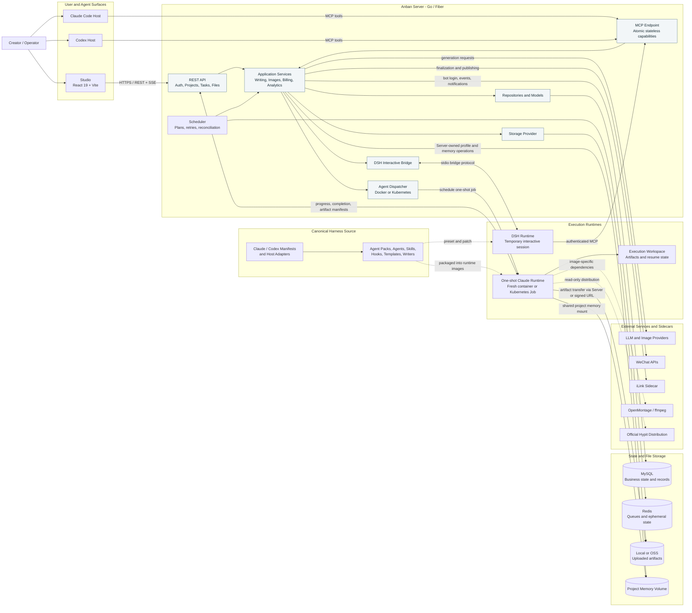

# Anban 内容生成操作系统

Anban 面向自媒体与品牌内容团队，把选题判断、内容与素材生成、发布记录、数据回流和效果复盘放进同一个工作空间，帮助团队持续产出高质量内容，并改进下一轮创作。

Anban is a content generation operating system: its Studio, Server, MCP capabilities, and managed Agents connect content production with publishing records and performance analysis.

## 内容闭环

围绕每个品牌或账号项目，Anban 将创作上下文、热点与选题、AI 内容生产、交付与发布状态、表现数据和复盘记录连接起来。数据分析用于观察内容效果并支持后续决策；归因洞察需要经过用户确认，并由后续独立的数据版本验证后才能成立。

## Product Surfaces

- **Web Studio** — manage content projects, plans, generated works, performance analysis, credits, model settings, and publishing state.
- **MCP Server** — exposes atomic writing, image, publishing, billing, and Seednote capabilities to connected agents.
- **Agent Runtime** — dispatches `article`, `seednote`, and related managed work to one-shot containers.
- **Content Workflow** — connects topic research, drafts, final content, visual assets, delivery packages, publishing records, and performance review.
- **Plugin Assets** — Claude Code and Codex share one plugin source under `harness/`, with native manifests and host adapters for each harness.

Managed execution uses a separate image identity for every Agent Pack, including
`creator-agent-wechat-article`, `creator-agent-wechat-picture`,
`creator-agent-seednote`, `creator-agent-montage`, and
`creator-agent-video-edit`. Images share the same plugin tree and may reuse a
Dockerfile when their system dependencies match.
种草笔记 research flows through the Server's configured research capabilities.
Their independent build definitions, together with the Server, Studio, and
sidecar iLink definitions, live in `deploy/docker/` and use the repository root as the
Docker build context.

## System Architecture



The Server owns identity, business state, execution scheduling, persistence,
publication policy, and external side effects. Harness Agents and Skills own
the non-deterministic generation workflow and produce artifacts; the Server
validates and persists those artifacts. MCP exposes one capability per call and
does not orchestrate workflow steps. Managed Agent runs use a fresh execution
environment, while DSH sessions are a separate interactive path.

## Managed Agent Runtime

The Server scheduler dispatches every managed execution to a fresh container:
Docker locally or a Kubernetes Job in production. There is no persistent Agent
service and no Server-owned execution directory. The runtime owns the task
workspace and output, retains resume state in the task workspace volume, and
uploads registered task artifacts back through the Server API.

The shared scheduler configuration is:

- `ANBAN_AGENT_EXECUTOR`: `docker` or `kubernetes`.
- `ANBAN_AGENT_IMAGE_WECHAT_ARTICLE`: the WeChat article Agent image.
- `ANBAN_AGENT_IMAGE_WECHAT_PICTURE`: the WeChat picture Agent image.
- `ANBAN_AGENT_IMAGE_SEEDNOTE`: the independent Seednote workflow image; its research uses public sources and configured Server capabilities.
- `ANBAN_AGENT_IMAGE_MONTAGE`: the OpenMontage, Remotion, and ffmpeg runtime image.
- `ANBAN_AGENT_IMAGE_VIDEO_EDIT`: the independent video editing image with the pinned `browser-use/video-use` runtime and ffmpeg.
- `ANBAN_AGENT_EXECUTION_TOKEN_SECRET`: a private value of at least 32 bytes used
  to mint short-lived workload tokens.

The Server never builds missing runtime images. `make docker-up` builds the
Server and configured local Agent images from the same checkout before starting
Compose; direct `docker compose` users must build or pull them first. Production
deployments should publish and select immutable image digests so a persisted
execution can always resume with the same runtime identity.

The Docker executor requires access to a Docker daemon. Compose mounts
`/var/run/docker.sock` into the Server and uses the host socket group through
`DOCKER_GID`; anyone deploying the Server another way must provide equivalent
daemon access. Kubernetes instead uses the namespace, task/project PVC storage
classes, and ServiceAccount settings in `server/Deployment.yaml`, while reading
the execution token secret from a Kubernetes Secret.

For an ACK release, build and push the Server, the independent DSH runtime
image (`deploy/docker/Dockerfile.runtime-dsh`), and every managed Agent image
from the same checkout. Set `dsh.image` in the mounted Server `config.yaml` to
the newly pushed DSH image, using any Docker-compatible image reference (a
bare name, registry tag, commit-SHA tag, or digest), before the
Server rollout. Rebuilding only the Server leaves interactive Pods on the old
Bridge protocol and can make a session close immediately after `session/start`.
Image tags and immutable digests are both accepted; digests remain recommended
when rollback safety matters.
Set `agent_service_account` to exactly the value configured at
`claude.kubernetes.service_account`. Render the ACK release with
`scripts/render-ack-server-deployment.sh`; its default output contains the
TokenReview ClusterRole/ClusterRoleBinding before the Server Deployment and
the namespace-scoped ServiceAccount, Role, and RoleBinding required by the Job
and DSH controllers. Applying only `server/Deployment.yaml` leaves the Server
unable to verify Agent workload tokens and causes every managed task to fail at
bootstrap.

After the pipeline rollout, the effective permissions can be checked with:

```bash
export namespace=anbanai-prod
export agent_service_account=creator-agent-runner
scripts/render-ack-server-deployment.sh \
  --manifest release/agent-runtime-manifest.json \
  --output /tmp/server-release.yaml
kubectl apply -f /tmp/server-release.yaml
kubectl auth can-i create secrets \
  --as="system:serviceaccount:${namespace}:${agent_service_account}" \
  -n "${namespace}"
kubectl auth can-i list pods \
  --as="system:serviceaccount:${namespace}:${agent_service_account}" \
  -n "${namespace}"
kubectl auth can-i create tokenreviews.authentication.k8s.io \
  --as="system:serviceaccount:${namespace}:${agent_service_account}"
kubectl auth can-i create jobs \
  --as="system:serviceaccount:${namespace}:${agent_service_account}" \
  -n "${namespace}"
kubectl auth can-i update jobs \
  --as="system:serviceaccount:${namespace}:${agent_service_account}" \
  -n "${namespace}"
kubectl auth can-i update pods \
  --as="system:serviceaccount:${namespace}:${agent_service_account}" \
  -n "${namespace}"
kubectl auth can-i create pods/attach \
  --as="system:serviceaccount:${namespace}:${agent_service_account}" \
  -n "${namespace}"
kubectl auth can-i list persistentvolumeclaims \
  --as="system:serviceaccount:${namespace}:${agent_service_account}" \
  -n "${namespace}"
kubectl auth can-i patch secrets \
  --as="system:serviceaccount:${namespace}:${agent_service_account}" \
  -n "${namespace}"
```

All checks must return `yes`. If the TokenReview check returns `no`, inspect
`kubectl get clusterrolebinding creator-server-tokenreview -o yaml` and
reapply the rendered release manifest to confirm it names
`system:serviceaccount:${namespace}:${agent_service_account}`.
If either namespace-scoped check returns `no`, inspect the active Role and
binding with `kubectl -n "$namespace" get role creator-agent-runner -o yaml`
and `kubectl -n "$namespace" get rolebinding creator-agent-runner -o yaml`
before restarting the Server.

Run `make agent-pack-generate && make agent-pack-check` before building so the
generated Server and Harness Catalog files are current. Then run
`make agent-runtime-release-manifest` may record the selected image references
for audit. Use the same renderer to inject that image set into the combined ACK release
manifest. Pass `--server-only` only when the separate
`deploy/k8s/ack-agent-runtime.yaml` has already been applied by the pipeline.
The runtime bootstrap still compares the Server's embedded Catalog digest with
the Catalog shipped in each Agent image; no Docker build argument or image label
is required.

## Quick Start

```bash
# Create the local Server environment file.
cp .env.example .env
# Fill every required value in .env before starting Compose.

# Start infra and services with Docker Compose
# (builds the Server and managed runtime images before startup)
make docker-up

# Or run server and web separately during development
make server-dev
make web-dev
```

Server build:

```bash
make server-build
./bin/anban-creator-server -config server/config.yaml
```

Frontend build:

```bash
make web-build
```

## Development Commands

```bash
# Go tests
cd server && go test ./...

# Frontend tests
cd studio && bun run test

# Frontend production build
cd studio && bun run build

# Claude runtime
cd runtime-claude && npm ci && bun run test && bun run typecheck && bun run build

# DSH interactive runtime
cd runtime-dsh && npm ci && bun run test && bun run typecheck && bun run build

# Format and vet Go code
make fmt
make vet
```

## Core Workflow

1. Create a channel in Studio with platform, account positioning, keywords, style, theme, and optional publishing credentials.
2. Create a manual task or scheduled plan.
3. The agent writes canonical artifacts into `output/`.
4. The server uploads task files and builds workflow metadata from known artifacts.
5. Studio shows stage progress, generated files, review readiness, warnings, and publishing state.
6. Optional auto-publishing creates WeChat article draft entries when enabled.

Canonical Creation Workflow v1 artifacts include:

- `01-topic.json`
- `02-outline.md`
- `03-draft.md`
- `04-final.md`
- `05-article.html`
- `cover.png`
- `images.json`
- `draft.json`
- `review.json`

## Supported Platforms

- **公众号文章** — long-form Markdown/HTML conversion, cover generation, WeChat draft publishing.
- **种草笔记/Seednote** — profile-assisted content creation and export formatting; direct publishing is not part of v1.

## Configuration

Server configuration lives in the local, gitignored `server/config.yaml`. Create it from the tracked example before first run:

```bash
cp server/config.example.yaml server/config.yaml
```

Important sections:

- database and Redis
- Claude Code executor
- storage provider
- image generation providers
- writing model defaults
- WeChat auth and publishing settings
- credits and invitation rules

Docker Compose loads the root `.env` into the Server container and rejects a
startup with any required value missing. Populate all required entries from
`.env.example`: `ANBAN_BILLING_ADMIN_API_KEY`, a 32-byte or longer
`ANBAN_AGENT_EXECUTION_TOKEN_SECRET`, `ANBAN_JWT_SECRET_KEY`, `ANBAN_OSS_ENDPOINT`,
`ANBAN_OSS_ACCESS_KEY_ID`, and `ANBAN_OSS_ACCESS_KEY_SECRET`, plus
`MOONSHOT_API_KEY` for the configured writing
and understanding routes. The checked-in image routes also require
`VOLCENGINE_ARK_API_KEY` and `WANGCAI_OPENAI_API_KEY`. Add any other provider and
integration variables referenced by `server/config.yaml` directly to `.env`;
the relevant optional feature remains unavailable until its credentials are
configured.

The application recognizes exactly three Agent product IDs: `effective`,
`balanced`, and `quality`. Their provider, model, and Claude Code settings live
only under each `claude.profiles.<id>.envs` map. The checked-in
configuration uses DeepSeek, Zhipu, and Moonshot, so set
`ANBAN_DEEPSEEK_ANTHROPIC_BASE_URL` plus `ANBAN_DEEPSEEK_API_KEY`,
`ANBAN_ZHIPU_ANTHROPIC_BASE_URL` plus `ANBAN_ZHIPU_API_KEY`, and
`ANBAN_MOONSHOT_ANTHROPIC_BASE_URL` plus `ANBAN_MOONSHOT_API_KEY` before the
Server starts. A configured profile must include its Base URL, Token, default
model, and the Opus/Fable/Sonnet/Haiku model variables. The remaining Claude
control variables are optional and may be removed to use provider defaults.
Invalid or incomplete configured profiles fail closed; execution never falls
back to another profile or model.

Server-owned research is configured independently under capability-level
`search.web`, `search.fetch`, and `search.images` routes. Enable web search with
`search.web.enabled: true` and choose `deepseek`, `doubao_custom`, or
`doubao_global`; enable page fetching separately with
`search.fetch.enabled: true` and provider `deepseek`. Credentials and endpoint
URLs live under `search.providers` and never reach an Agent. DeepSeek Search
and Fetch do not use a model parameter. To enable image search, set
`search.images.enabled: true`, `search.images.provider: doubao`, and configure
`search.providers.doubao.api_key` (or `ANBAN_DOUBAO_SEARCH_API_KEY` in the
Server environment); image search uses the Global endpoint and accepts a text
query with up to five results, matching the documented text-to-image API.
Agents use only the execution-scoped `search_web`, `fetch_web_page`, and
`search_images` MCP tools. Provider credentials and selection stay on the
Server. Each capability has its own zero-priced SKU, quote, charge,
idempotency namespace, and provider-cost evidence.

DSH interactive sessions run in one isolated workload per session and have an explicitly configured Docker image reference under `dsh.image`; the Server creates a non-restarting Pod and attaches through `pods/exec`. Use `executor: container` for local Docker development.
`dsh.route` selects one route for the next session; it does not read or modify
`claude.profiles`. A route declares its provider, wire API, endpoint, model,
and the credential value using the same `${...}` expansion as Claude:

`base_url` must be the actual HTTP(S) endpoint with an ASCII DNS hostname, such
as `https://api.deepseek.com/anthropic`. Do not put a descriptive label or
Chinese text in the Secret key `deepseek-anthropic-base-url`; the Server rejects
that value before a DSH session starts.

```yaml
dsh:
  enabled: true
  # Maximum lifetime of the resumable DSH session and runtime.
  timeout_sec: 86400
  route: effective
  routes:
    effective:
      provider: anthropic
      api: anthropic-messages
      base_url: https://api.deepseek.com/anthropic
      api_key: "${ANBAN_DEEPSEEK_API_KEY}"
      model: deepseek-flash
```

The independent DSH runtime container starts the official DSH runtime as `dsh --profile sdk`, writes the
selected route into temporary DSH settings using the official `apiKeyEnv`,
`api`, `baseURL`, and `models` fields, and calls `initialize({ provider,
model })`. `api_key` uses the same `${...}` expansion as Claude's `envs`; the
resolved value is placed in an isolated per-session internal variable. The
child receives only `DSH_HOME`, the internal
`ANBAN_DSH_BRIDGE_PROVIDER_API_KEY` provider-key variable, and the
documented `ANBAN_DSH_BRIDGE_*` Bridge protocol variables. Those variables are
internal transport settings; they are not user-facing DSH provider settings.

Deployments may select different Anthropic-compatible models by changing the
profile `envs` values and the corresponding `model_usage_aliases` plus provider
cost catalog entries. Do not rename the three product IDs, derive a profile
from a SKU string, or put provider credentials in tasks, snapshots, or billing
records.

Kubernetes reads the billing and execution-token values from Secret
`anban-billing-admin-api-key`, key `api-key`, and Secret
`anban-agent-execution-token`, key `token-secret`, respectively. Configure the
Agent profile variables through Secret `anban-agent-profile-providers`
using keys `deepseek-anthropic-base-url`, `deepseek-api-key`, `moonshot-api-key`,
and `zhipu-api-key`. The Deployment pins the official Moonshot and Zhipu
Anthropic-compatible Base URLs as non-secret values. Configure the
remaining `server/config.yaml` environment references through the deployment's
Secret/config injection. Do not put credentials directly in manifests or
config files.

For DSH, reuse the existing `ANBAN_*` environment references used by Claude in
the route's `api_key` value. No additional DSH credential variable or Secret
mapping is required.

### Agent profile migration runbook

This release is an incompatible maintenance-window migration. First back up the
database, record task/plan/execution/profile/Quote counts, pause task creation,
plan scheduling, retries, and Agent consumers, then drain or explicitly cancel
every `starting` or `running` execution. Rehearse the complete sequence and
restore on a production-sized database copy before touching production.

Deploy the new Server image with traffic still disabled and run, in order:

```bash
mysql --defaults-extra-file=/secure/mysql.cnf anban_creator \
  < server/migrations/20260730_agent_profile_envs_expand.sql

go run ./server/cmd/agent-profile-envs-backfill \
  --config server/config.yaml --batch-size 500 \
  --legacy-provider-base-url 'volcengine_ark=https://ark.cn-beijing.volces.com/api/compatible' \
  --dry-run
go run ./server/cmd/agent-profile-envs-backfill \
  --config server/config.yaml --batch-size 500 \
  --legacy-provider-base-url 'volcengine_ark=https://ark.cn-beijing.volces.com/api/compatible'
go run ./server/cmd/agent-profile-envs-backfill \
  --config server/config.yaml --batch-size 500 --verify-only

mysql --defaults-extra-file=/secure/mysql.cnf anban_creator \
  < server/migrations/20260730_agent_profile_envs_expire_quotes.sql
mysql --defaults-extra-file=/secure/mysql.cnf anban_creator \
  < server/migrations/20260730_agent_profile_envs_contract.sql
```

Repeat `--legacy-provider-base-url` for every historical snapshot Provider that
differs from the current Provider assigned to the same product profile. The
20260728 migration created `balanced` snapshots with `volcengine_ark`, so that
mapping is required when the current `balanced` example uses Zhipu. Use the
actual historical production endpoint if it differed from the example above.
The mapping restores only the non-secret frozen endpoint; it does not restore a
legacy Token or make a historical task executable after its product profile
changes Provider.

Do not run Contract DDL before `--verify-only` succeeds. The Contract phase
drops legacy execution columns and cannot be rolled back by enabling old IDs;
rollback means restoring the maintenance-window backup. Afterward, publish
catalog `retail-2026-07-30-v7`, mount the new profile config and Secrets, start
the Server, and verify `/api/v1/agent/execution-profiles` exposes only the three
new IDs with the expected availability. Then deploy Studio and the TypeScript
Agent images from this repository, deploy Miniapp from its private companion
repository, verify Free/Pro/Enterprise creation, retry,
billing detail, and total charge flows, and only then resume schedulers,
consumers, and user traffic.

Users can configure per-account platform credentials and per-user model settings from Studio.

## Repository Layout

```text
server/       Go module: API server plus server/app reusable content and publishing packages
runtime-claude/     TypeScript Agent runtime used by Docker/Kubernetes managed execution
runtime-dsh/        TypeScript DSH runtime used by temporary interactive sessions
studio/       React Web Studio
harness/ Unified Claude Code and Codex plugin: shared skills plus native agents, manifests, MCP, hooks, and installers
docs/         Design specs and implementation plans
```

The WeChat Mini Program parity client is maintained in the private
[anbanai/creator-miniapp](https://github.com/anbanai/creator-miniapp) companion repository.

## Testing

Run full backend and frontend verification before shipping:

```bash
cd server && go test ./...
cd studio && bun run test
cd studio && bun run build
```

## License

MIT
