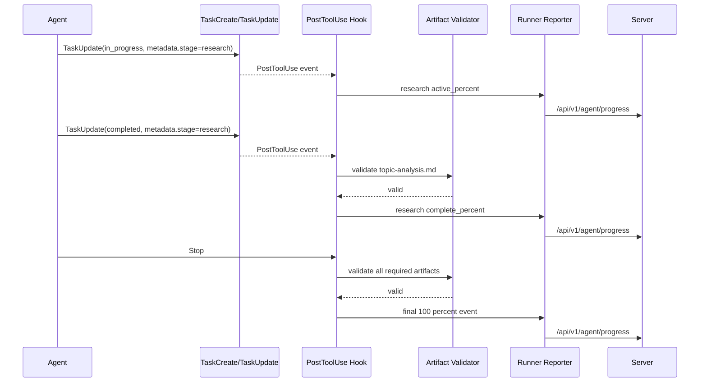

# Agent Progress Hooks Design

## Status

Approved design baseline. This document describes the target architecture; it does not implement the runtime changes.

## Context

Agent progress currently has two different paths:

1. `agent-ts` reports model text, tool usage, stderr, and heartbeats through `Reporter` and `/api/v1/agent/progress`.
2. Agent instructions call the Anban MCP tool `update_task_progress` directly for business stages. The server persists the structured stage, calculates a percentage, and publishes SSE events.

The second path couples every Agent Pack to an Anban-specific MCP contract. Stage names and percentages are also duplicated in `plugins/packs/*/agent-pack.yaml` and `server/service/task_progress_stages.go`.

The goal is to remove direct `update_task_progress` calls from Agent instructions while preserving reliable, structured, real-time progress for the Studio and task APIs.

## Goals

- Use official task lifecycle primitives as the Agent-side stage signal.
- Make Agent Pack metadata the single declaration source for stage titles, percentages, and required artifacts.
- Observe task events in the Runner without adding business orchestration to Hooks.
- Validate stage completion from file-backed artifacts before advancing progress.
- Preserve the existing server persistence, SSE, heartbeat, and completion contracts where possible.
- Keep a clear host boundary: Claude SDK Hook support is implemented first; Codex uses an adapter with the same event contract.
- Make progress updates idempotent, monotonic, and recoverable across retries.

## Non-goals

- Do not infer business stages from arbitrary model text.
- Do not use `/btw`, periodic model prompts, or another model turn as telemetry.
- Do not make Hooks call domain MCP tools or compose business services.
- Do not make artifact presence the only source of stage start events.
- Do not introduce a persistent Agent service or a shared workspace mount.

## Design Principles

### Task metadata is the semantic signal

Claude Agent SDK `TaskCreateInput` and `TaskUpdateInput` support arbitrary metadata. Agents create and update ordinary tasks, adding a stable stage key:

```json
{
  "subject": "选题研究",
  "description": "完成选题分析并写出 output/topic-analysis.md",
  "metadata": {
    "anban_progress_stage": "research"
  }
}
```

The same metadata is included on the `TaskUpdate` that changes the task to `in_progress` or `completed`. This avoids parsing localized task subjects and keeps the signal in the official task tool contract.

The Agent instructions still describe the workflow and stage key, but they no longer know or call an Anban progress MCP tool.

### Agent Pack is the declaration source

The current `ProgressStage` type only carries `id` and `title`. It should be extended so the generated Agent Pack Catalog contains the complete progress contract:

```yaml
progress:
  - id: research
    title: 选题研究
    active_percent: 10
    complete_percent: 20
    required_artifacts:
      - output/topic-analysis.md

  - id: writing
    title: 内容创作
    active_percent: 30
    complete_percent: 60
    required_artifacts:
      - output/04-article-final.md

  - id: delivery
    title: 交付验收
    active_percent: 80
    complete_percent: 100
    required_artifacts:
      - output/05-article.html
      - output/final-review.md
```

`active_percent` is emitted when the stage becomes active. `complete_percent` is emitted only after artifact validation succeeds. Pack stages are ordered as declared; the Runner and service apply a monotonic guard for retries, duplicate events, and out-of-order branches.

For stages whose artifacts are conditional, the schema should support an explicit validation mode rather than an implicit convention. The initial implementation only needs `required_artifacts` with a non-empty-file check; image and JSON-specific validators can be added as typed validators later.

### Hooks observe; they do not orchestrate

The Claude Runner registers a `PostToolUse` matcher for `TaskCreate|TaskUpdate` and a `Stop` Hook. Hooks may:

- inspect the official tool input and result;
- look up the immutable Agent Pack progress contract;
- read task-local files for artifact validation;
- enqueue a structured progress event through the Runner Reporter;
- return `additionalContext` when a completed stage is missing required artifacts;
- block a final stop when the final artifact contract is not satisfied.

Hooks must not call `generate_image`, `get_project_profile`, or other domain capabilities, and must not decide workflow order. The Agent and Skills remain responsible for workflow decisions.

## Event Flow



## Runner Components

### ProgressEmitter

Add a Runner-local component with the following responsibilities:

- resolve `agent_pack_id` and the matching progress stage from the runtime Catalog;
- accept `active`, `complete`, and `final` events;
- ignore unknown stage keys and record a diagnostic rather than failing the Agent;
- deduplicate identical `(stage, state)` events;
- serialize concurrent Hook callbacks so progress is monotonic;
- call a structured Reporter method asynchronously with bounded retry;
- keep heartbeat failures independent from progress failures.

The existing `Reporter.progress()` remains available for free-form logs. Add a structured method, for example `Reporter.stageProgress(...)`, that posts the stage, title, description, and percent using the existing authenticated `/api/v1/agent/progress` contract. A Hook/reporting failure must not turn a successful Agent execution into a failed business task.

### PostToolUse task observer

The observer matches `TaskCreate|TaskUpdate`.

- On `TaskCreate`, record the task id returned by the tool result and its `anban_progress_stage` metadata. If the tool result is malformed, emit a diagnostic only.
- On `TaskUpdate` with `status=in_progress`, resolve the stage from the update metadata or the Runner's task-id map and emit `active_percent`.
- On `TaskUpdate` with `status=completed`, validate the stage's artifacts. Emit `complete_percent` only on success.
- On a missing artifact, return non-blocking `additionalContext` explaining the missing paths so the Agent can repair the stage. Do not call domain tools from the Hook.
- On deleted or unrelated tasks, do nothing.

The task-id map is process-local for normal execution. For resume safety, the Agent must repeat the stage metadata on `TaskUpdate`; this makes each event self-describing and avoids relying on an in-memory map after a fresh runtime starts.

### Stop Hook

The Stop Hook runs the Agent Pack's final artifact validator. It must:

- reject success when a required artifact is absent, empty, malformed, or when `output/failure-state.json` is present;
- return `additionalContext` or a blocking Stop decision according to the existing managed stop-gate behavior;
- emit the final structured progress event only after validation succeeds;
- remain idempotent when Stop fires more than once.

The existing Seednote quality gate remains a domain-specific quality check. The generic artifact validator does not replace it; it supplies the common delivery contract around it.

## Server Contract

Extend `agentProgressRequest` so the same authenticated endpoint accepts either a free-form log or a structured stage event:

```json
{
  "task_id": "...",
  "message": "",
  "stage": "research",
  "title": "选题研究",
  "description": "topic-analysis.md 已生成",
  "progress_percent": 20
}
```

The Handler remains thin. It authenticates the execution, refreshes the heartbeat, and delegates structured events to `TaskService.UpdateProgress`. The service resolves the stage against the execution's locked Agent Pack identity and applies the existing monotonic persistence and SSE behavior.

Remove the duplicated task-type map in `server/service/task_progress_stages.go` after the Agent Pack Catalog can resolve stage percentages. Existing unknown-stage behavior should remain non-destructive: persist a log diagnostic if needed, but never roll the progress column backward.

The execution snapshot already stores Agent Pack id, version, digest, runtime profile, and adapter. Progress resolution must use that snapshot, not the mutable current plugin tree, so a resumed task keeps the same contract.

## `/btw` Evaluation

`/btw` is suitable only as a user-facing, ad-hoc summary mechanism. It is not suitable as the source of machine progress because it requires an extra model turn, has no delivery guarantee, can be stale or subjective, and does not provide a durable structured event.

For pull-based UI behavior, Studio should read `latest_progress` and the existing task SSE stream. If a natural-language summary is desired, `/btw` may summarize those structured fields, but it must not be responsible for writing them.

## Host Compatibility

The Claude Agent SDK path has formal `PostToolUse` and `Stop` Hooks and is the first implementation target.

The Codex Agent Pack source must use the same `anban_progress_stage` Task metadata convention, but the repository currently does not expose an equivalent generic Codex Hook adapter. Before removing progress calls from Codex sources, add an adapter that converts Codex Task events into the same internal `ProgressEvent` shape. Until that adapter is implemented and tested, Claude and Codex migration must not be claimed complete.

The shared Agent Pack and task metadata contract is host-neutral; the event observation mechanism is host-specific.

## Migration Plan

1. Extend `server/agentpack.ProgressStage` and pack YAML validation/generation with percentages and artifact rules.
2. Add progress metadata to the generated Agent Pack Catalog and expose it to the Runner.
3. Add structured `Reporter.stageProgress()` and server request handling.
4. Implement `ProgressEmitter`, task observer, and generic Stop artifact validation in `agent-ts`.
5. Convert one small Pack, such as `moments`, to Task metadata and remove its direct progress MCP calls.
6. Add focused Runner, artifact, server handler, service, and pack contract tests.
7. Migrate article, seednote, ecommerce, montage, and live-slicer Claude sources.
8. Implement and test the Codex runtime adapter.
9. Remove `update_task_progress` from all Agent sources and remove the obsolete server stage map.
10. Run full Go, Agent Runtime, and plugin contract verification before release.

## Testing Requirements

- Agent Pack catalog rejects duplicate stage ids, invalid percentages, unknown artifact paths, and incomplete stage declarations.
- PostToolUse emits active and complete events exactly once for duplicate TaskUpdate calls.
- Stage completion does not advance when a required artifact is missing or empty.
- Stop blocks final success when required artifacts are missing or `failure-state.json` exists.
- Reporter retries structured events without blocking completion indefinitely.
- Server accepts structured progress, refreshes heartbeats, persists latest progress, and publishes SSE events.
- A lower or out-of-order percentage never rolls the task backward.
- Resume execution works when `TaskUpdate` repeats stage metadata in a fresh process.
- Codex adapter produces the same internal events as the Claude Hook adapter.

## Risks and Mitigations

- **Agent forgets metadata:** add a pack contract test and a generic additional-context reminder when a TaskCreate/TaskUpdate has no stage metadata.
- **Natural-language task changes:** never parse subjects for the primary path; metadata is the only authoritative signal.
- **Hook/reporting outage:** progress is best-effort and independent of terminal completion; heartbeat and completion remain authoritative.
- **Artifact false positives:** start with non-empty-file checks and allow typed validators for JSON/image/video artifacts where required.
- **Codex feature mismatch:** keep the host-neutral event schema and delay removal from Codex sources until its adapter is verified.

